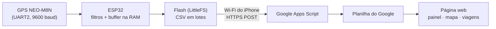
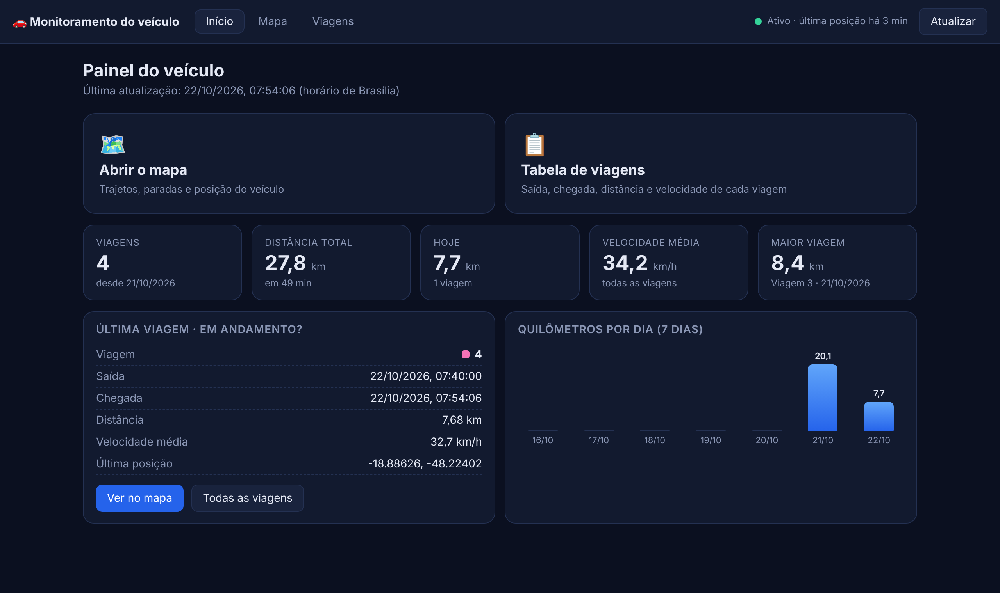
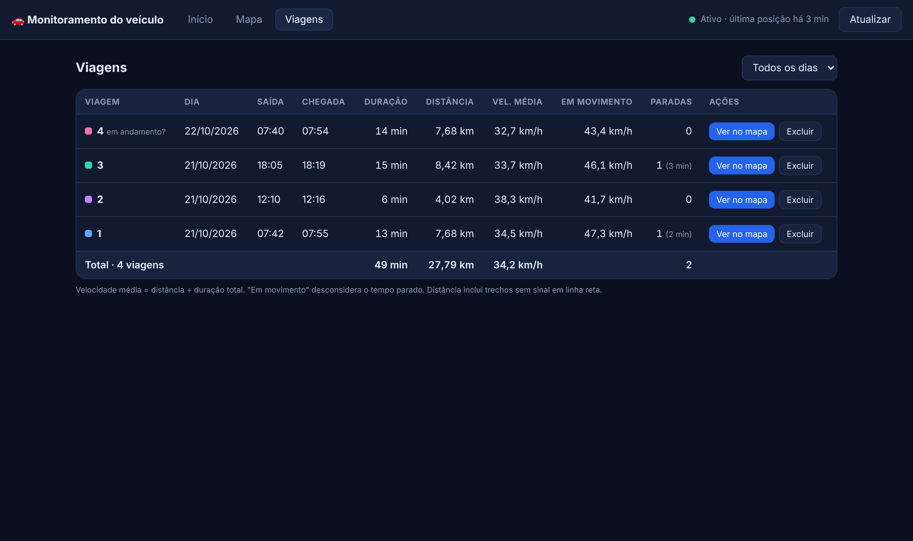
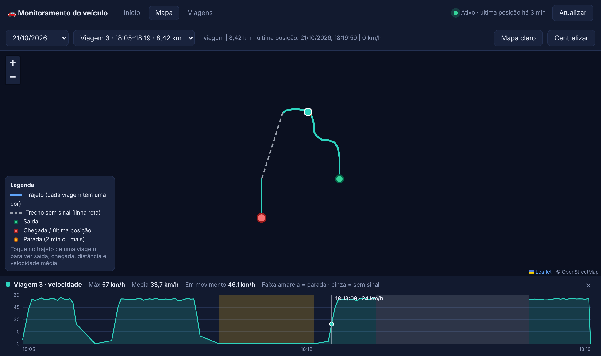

# Monitoramento GPS veicular com ESP32

Sistema de rastreamento de um carro com **ESP32 + módulo GPS NEO-M8N**, feito como desafio de um processo
seletivo de estágio em hardware embarcado. O trajeto é **guardado na flash da ESP32**, enviado para uma
**planilha do Google** quando há Wi-Fi e exibido em uma **página web** (painel, mapa e tabela de viagens).

> Princípio de projeto: *guardar e encaminhar* (store-and-forward). O rastreamento nunca depende da internet, e
> nenhum dado é apagado da ESP32 antes de o servidor confirmar o recebimento.

## Como funciona



- **Filtro de qualidade:** só grava com fix válido, pelo menos 5 satélites e HDOP até 3,0.
- **Veículo parado:** ancora a posição (média) dentro de 50 m, eliminando a deriva do GPS parado.
- **Hora de Brasília:** o GPS entrega UTC; o firmware converte para UTC-3 (virada de dia, mês, ano e bissexto).
- **Viagens:** cada vez que a ESP32 liga conta como uma viagem nova (contador guardado na memória NVS).
- **Chegada não se perde:** ao parar, o ponto é gravado na hora na flash, pois ao desligar o carro a RAM se perde.
- **Wi-Fi sem travar:** máquina de estados não bloqueante; o arquivo só é apagado após a resposta `OK n`.
- **LED azul da ESP32:** pisca rápido (sem fix), aceso fixo (gravando) e 3 piscadas (envio concluído).

## Interface web

Tema escuro, com três telas: **Início** (indicadores e resumo), **Mapa** (trajetos coloridos por viagem, paradas,
trechos sem sinal, gráfico de velocidade) e **Viagens** (tabela com saída, chegada, duração, distância, velocidade
média e paradas, com opção de excluir a viagem).

| Início | Viagens |
|---|---|
|  |  |



*As capturas usam dados de demonstração simulados (o fundo do mapa não aparece porque foram geradas sem internet).*

## Hardware

| Item | Observação |
|---|---|
| ESP32 de 30 pinos | programada pelo Arduino IDE (placa: ESP32 Dev Module) |
| Módulo GPS NEO-M8N | conector SMA, serial 9600 baud |
| Antena GPS ativa externa | base magnética, ideal no painel perto do para-brisa |
| Alimentação | porta USB do carro (5 V) |

Ligações:

| NEO-M8N | ESP32 |
|---|---|
| VCC | 3V3 |
| GND | GND |
| TXD | RX2 (GPIO16) |
| RXD | TX2 (GPIO17) |
| PPS | (solto) |

## Como usar

1. **Planilha:** crie uma planilha do Google e escreva na linha 1:
   `data_hora, lat, lon, vel_kmh, satelites, viagem`.
2. **Apps Script:** em *Extensões > Apps Script*, cole `apps-script/Codigo.gs`, troque a senha em `CHAVE`,
   crie um arquivo HTML chamado `mapa` com o conteúdo de `apps-script/mapa.html` e implante como **App da Web**
   (executar como *Eu*, acesso *Qualquer pessoa*). Para atualizar depois, use *Gerenciar implantações > Nova versão*.
3. **Firmware:** abra `firmware/rastreador_gps/rastreador_gps.ino`, instale a biblioteca **TinyGPSPlus**, preencha
   `WIFI_SSID`, `WIFI_SENHA` e `URL_SCRIPT` (a URL termina em `/exec`) e carregue na ESP32.
   Para testar sem GPS use `USAR_GPS_SIMULADO 1`.
4. **Mapa:** abra `https://script.google.com/macros/s/SEU_ID/exec?k=SUA_SENHA`.

O passo a passo detalhado está em [`docs/Tutorial_Instalacao_Projeto_GPS.pdf`](docs/Tutorial_Instalacao_Projeto_GPS.pdf).

Comandos no Monitor Serial (115200 baud): `l` listar arquivos, `m` mostrar conteúdo, `x` apagar tudo, `w` enviar agora.

## Estrutura do repositório

```
firmware/rastreador_gps/   código da ESP32 (.ino)
apps-script/               Codigo.gs (doPost, doGet, getPontos, excluirViagem) e mapa.html (página web)
tests/                     simulação do firmware no PC e testes do Apps Script
docs/                      relatório final, apresentação, tutorial de instalação e imagens
```

## Testes

Veja [`tests/README.md`](tests/README.md). Resumo: o firmware é compilado e executado no PC com entrada NMEA
simulada, e as funções do Apps Script são executadas em ambiente simulado. A interface foi verificada com navegador
automatizado e dados simulados. A precisão do GPS e o tempo até o primeiro fix dependem de antena e céu aberto, e
devem ser avaliados em campo.

## Limitações conhecidas

- Não é tempo real puro: o mapa mostra o que já foi enviado (depende do intervalo de envio).
- A cada ignição o NEO-M8N começa "a frio"; uma bateria no pino `V_BCKP` acelera o primeiro fix.
- Segurança de demonstração: senha simples no endereço e HTTPS sem validação de certificado.
- O envio ocupa a ESP32 por alguns segundos, sem ler o GPS.

## Próximos passos

Bateria de backup do GPS, módulo 4G para tempo real, display OLED de status, ventoinha com controle por temperatura,
replay da viagem e alerta de velocidade. Detalhes em [`docs/Relatorio_Final_Projeto_GPS_ESP32.pdf`](docs/Relatorio_Final_Projeto_GPS_ESP32.pdf).

## Licença

MIT. Veja [`LICENSE`](LICENSE). A cópia da biblioteca TinyGPSPlus em `tests/` mantém a licença original (LGPL 2.1).
